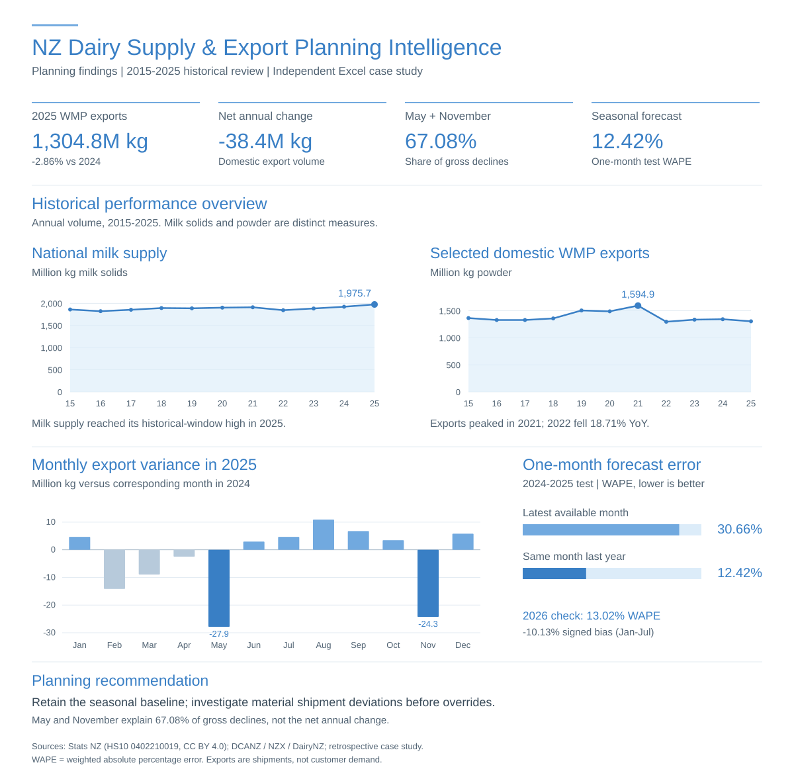
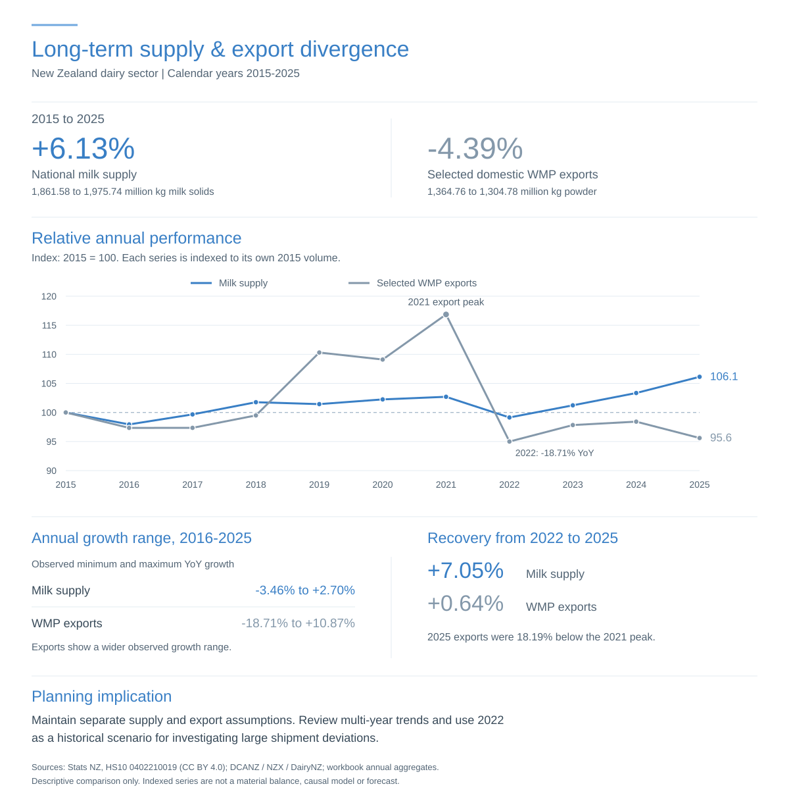
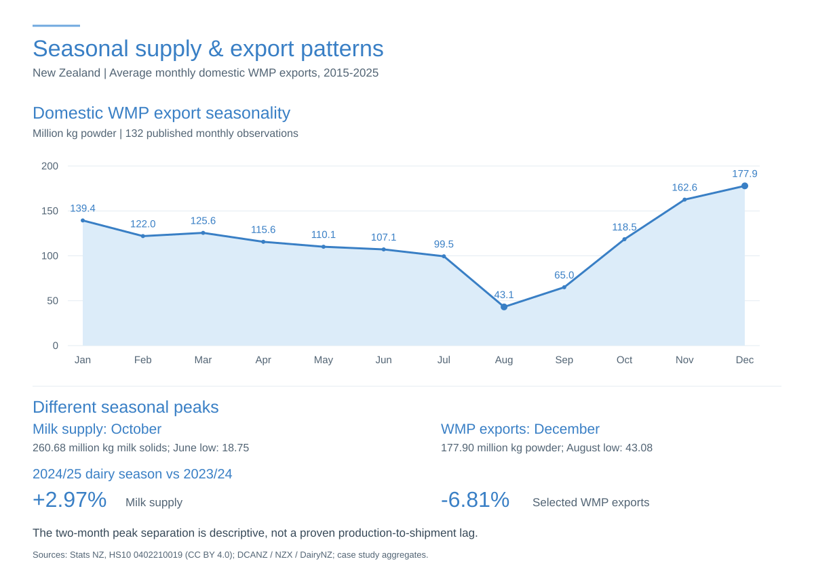

# NZ Dairy Supply & Export Planning Intelligence

**An Excel-based business analysis case study | New Zealand dairy sector | 2015-2025 historical review**

[Download the Excel planning workbook](excel/NZ_Dairy_Planning_Intelligence.xlsx) | [Data sources](data/README.md) | [Technical documentation](docs/excel_acceptance.md)

## Executive summary

This independent Excel-based case study examines whether earlier national milk supply improves forecasts of New Zealand domestic whole milk powder (WMP) exports. It combines historical performance, seasonal forecasting and exception review to support planning decisions.

| Coverage | Source review | Forecast test | Decision |
|:---|---:|:---|:---|
| **132 matched months** | **735,118 export rows screened** | **2024-2025 held-out period** | **Retain seasonal baseline** |

| 2025 performance | 2024 | 2025 | Change |
|:---|---:|---:|---:|
| Milk supply (million kg milk solids) | 1,923.86 | 1,975.74 | **+2.70%** |
| Selected domestic WMP exports (million kg powder) | 1,343.21 | 1,304.78 | **-2.86%** |

**Decision:** retain the same-month-last-year export forecast as the reference baseline.

*Analytical summary using the workbook's historical annual totals and published export records; not a workbook screenshot.*

## 1. Business problem and scope

**Question:** Can available milk supply observations improve a one- to three-month outlook for New Zealand domestic WMP exports compared with using export history alone?

The intended users are planning, supply chain and operations analysts reviewing monthly sector-level volumes and prioritising shipment deviations for investigation.

| Hypothesis | Test | Outcome |
|---|---|---|
| H1: Seasonality improves the forecast | Seasonal baseline vs latest-available-month forecast | Supported in the one-month held-out comparison |
| H2: Earlier milk supply improves WMP forecasting | Comparable export-only and supply-informed models, 1-3 months | Not supported in these tests |

## 2. Project workflow & methodology

| Step | Work performed | Output |
|---|---|---|
| 01. Define the business problem | Establish the planning question, research scope and two forecasting hypotheses. | Clear analytical objectives |
| 02. Collect and assess source data | Review the original milk and export statistics; select the relevant WMP product code. | Documented source files and selection criteria |
| 03. Clean, transform and merge | Use Power Query to filter exports, standardise dates and units, append annual files and join milk supply with exports by month. | Analysis-ready monthly dataset |
| 04. Validate and explore | Check completeness, duplicates and quantity reconciliation. Analyse calendar-year trends, dairy seasons, monthly variance and lagged relationships using the training data for the latter. | Audited dataset and historical planning insights |
| 05. Build and evaluate forecasts | Compare simple baselines and matched export-only and supply-informed regression models across one- to three-month horizons. Estimate fixed regression coefficients with Python/NumPy and apply them in Excel. | Model comparison using WAPE, MAE and signed bias |
| 06. Translate results into planning actions | Select the baseline on validation results, evaluate it on the test period, screen significant deviations and check unchanged seasonal forecasts against available 2026 actuals. | Forecast outlook, exception priorities and recommendations |
| 07. Build the Excel reporting solution | Consolidate the analysis into an interactive Excel planning report. | Executive Dashboard and supporting planning workbook |

### Forecast evaluation design

| Period | Purpose |
|---|---|
| 2015-2021 | Historical training window, subject to lag and release-delay requirements |
| 2022-2023 | Validation and model selection; establish the exception threshold |
| 2024-2025 | Held-out model evaluation, using coefficients refitted on available data through November 2023 |
| 2026 (partial year) | Additional retrospective check of the unchanged seasonal baseline; no model tuning |

Models use a common assumed one-month publication delay and identical target months within each horizon. See [forecast methodology](docs/forecast_evaluation.md) for the exact forecast origins, fitting windows and limitations.

## 3. Data sources and quality

| Source | Scope | Treatment |
|---|---|---|
| [DCANZ / NZX / DairyNZ](https://dcanz.com/resources/) | Monthly national milk solids collected for processing | Convert thousand kg to kg; retain 2015-2025 |
| [Stats NZ overseas merchandise trade](https://www.stats.govt.nz/large-datasets/csv-files-for-download/overseas-merchandise-trade-datasets/) | 11 annual national HS10 exports files | Filter HS10 0402210019; use domestic exports, KGM, Final |
| Joined monthly dataset | 132 months | Merge on month-start date; check duplicates, coverage and quantities |

All inputs are observed public statistics. The 11 original export CSVs contain 735,118 records; the selected 132 monthly records are Final, KGM and reconcile domestic plus re-exports to total exports. All 132 months match uniquely across the two sources. In the inspected workbook baseline, all 1,320 joined values match the audited snapshot within documented tolerances. Original export file integrity was verified against the [source manifest](data/raw_source_manifest.csv). The original milk workbook is not distributed separately; see [data sources and reuse](data/README.md) for the embedded milk data and unconfirmed redistribution permission.

### Data lineage and analytical outputs

| Stage | Published file or location | Role |
|---|---|---|
| Original exports | [11 annual CSVs](data/raw/) | Unchanged source records |
| Filtered source extract | [132 selected records](data/public/wmp_exports_2015_2025.csv) | Original field names and quantities |
| Cleaned exports | [Analysis-ready monthly exports](data/processed/wmp_exports_cleaned.csv) | Standardised dates, fields and units |
| Joined monthly dataset | [Power Query templates](powerquery/queries/) | Milk and export merge; embedded analytical dataset in the workbook |
| Model evaluation | [Forecast metrics](data/outputs/forecast_evaluation.csv) | 18 aggregate validation and test results |
| Additional evaluation | [2026 export performance](data/outputs/forecast_performance_2026.csv) | Seven observed export months |
| Exception review | [Planning exceptions](data/outputs/planning_exceptions.csv) | 24 test months, fixed threshold |

[Output definitions](data/outputs/README.md) explain units, error signs and source lineage. 

## 4. Key findings

### 01. Historical performance and long-term divergence

The Historical Overview worksheet compares all eleven calendar years, including annual YoY growth and export variance. The year selector supports 2016-2025; 2015 is the reference year because 2014 is outside the dataset.

| Historical comparison | Milk supply | Selected domestic WMP exports |
|---|---:|---:|
| 2015-2025 change | +6.13% | -4.39% |
| Annual YoY growth range (2016-2025) | -3.46% to +2.70% | -18.71% to +10.87% |
| 2022-2025 change | +7.05% | +0.64% |

Milk supply reached its historical-window high in 2025 (1,975.74 million kg milk solids), while selected WMP exports remained 18.19% below their 2021 peak of 1,594.85 million kg. The 2022 export contraction of 18.71% was followed by only 0.64% net growth through 2025, despite milk supply rising 7.05%. Annual export growth also spans a wider observed range than milk supply growth.

These are descriptive comparisons of observed volumes, not evidence of a structural break, causal relationship or company-specific supply constraint. Use the 2022 contraction as a historical review scenario rather than a forecast assumption. The 2025 versus 2024 comparison remains the latest complete-year deep dive; 2026 is a separate partial-year forecast check.

### 02. Seasonal supply and export patterns

Milk collection peaks in October (average 260.68 million kg milk solids) and reaches its low in June (18.75 million kg), with the peak approximately 13.9 times the low. The selected domestic WMP export series peaks in December and reaches its low in August. The two-month difference between average peaks is descriptive, not a demonstrated production-to-shipment lag.

The complete 2024/25 dairy season also shows divergence: milk supply rose 2.97% compared with 2023/24, while selected domestic WMP exports fell 6.81%. The June-May view complements the calendar-year review.

### 03. Supply-export divergence and monthly variance

Four months had opposite year-on-year directions: March, April, May and November. May and November were the largest monthly export declines in absolute volume compared with the corresponding 2024 months.

| Month | Milk supply YoY | Domestic WMP exports YoY | Export volume change |
|---|---:|---:|---:|
| May 2025 | +7.43% | -22.21% | -27.86 million kg |
| November 2025 | +2.69% | -15.52% | -24.27 million kg |

The 2025 net export decline of 38.43 million kg reflects gross decreases of 77.72 million kg, partly offset by 39.29 million kg of increases. May and November account for **67.08% of gross monthly decreases**, not the net annual change. Shipment timing, product mix and market context are potential investigation topics, not established causes.

### 04. Forecast model performance

One-month-ahead test error (WAPE, lower is better):

| Series | Latest available month | Same month last year |
|---|---:|---:|
| Milk supply | 47.02% | **3.16%** |
| Domestic WMP exports | 30.66% | **12.42%** |

| Horizon | Test months | Seasonal | Export only | Supply informed |
|---|---:|---:|---:|---:|
| 1 month | 24 | **12.42%** | 12.68% | 13.41% |
| 2 months | 23 | 12.15% | **11.85%** | 12.50% |
| 3 months | 22 | **10.63%** | 10.66% | 11.78% |

The export-only model was slightly better at the two-month test horizon, but adding milk supply did not improve the comparable export-only model at any horizon. These results do not establish statistical significance or causation. WAPE is total absolute forecast error divided by total actual volume.

### 05. Planning exceptions

A proposed review threshold of **39.08 million kg** was derived from the fifth-largest absolute seasonal forecast error in the 24-month validation period. Applying that fixed threshold to 2024-2025 flags one month.

| Review item | February 2024 |
|---|---:|
| Forecast | 85.76 million kg |
| Actual domestic exports | 138.60 million kg |
| Actual minus forecast | **+52.84 million kg** |
| Review threshold | 39.08 million kg |
| Action | Investigate shipment deviation |

The threshold is an analyst-proposed screening rule, not a confidence interval or approved business tolerance.

### 06. Additional forecast performance in 2026

| Additional retrospective check | Actual months | WAPE | Signed bias |
|---|---:|---:|---:|
| Milk supply, Jan-May 2026 | 5 | 5.92% | -5.92% |
| Domestic WMP exports, Jan-Jul 2026 | 7 | 13.02% | -10.13% |

The unchanged seasonal baseline underforecast both series over these partial-year periods. See [additional planning review](docs/planning_review.md).

## 5. Recommendations and monthly review process

| Recommended action | Proposed owner | Timing | Evidence to review |
|---|---|---|---|
| Use same-month-last-year as the export baseline | Planning analyst | Monthly | WAPE, MAE and signed bias |
| Maintain separate milk supply and export planning assumptions | Supply chain analyst | Monthly | Separate seasonal profiles, annual YoY movements and multi-year trends |
| Investigate unusually large shipment deviations before overriding the baseline | Planning and export operations | When threshold is exceeded | Dispatch timing, shipment schedules and reliable market context |
| Check source revisions before adopting refreshed analysis | Analyst responsible for reporting | Every refresh | 132-month reconciliation; refit coefficients if the historical snapshot changes |
| Review the exception threshold with stakeholders | Planning lead | Before operational adoption | Historical false alerts and missed material events |
| Monitor persistent forecast bias | Planning analyst | Monthly | Actual-versus-forecast performance and direction of errors |
| Review historical export contractions and recovery | Planning and export operations | Quarterly or when a material deviation occurs | 2022 contraction, recovery against prior peaks and available shipment or market evidence |

These are proposed actions for a planning review, not implemented company changes or verified financial benefits.

## 6. Excel solution

| Excel capability | Application |
|---|---|
| Power Query | Three native queries for source import, transformation and merging |
| Excel Tables and PivotTables | Structured data and two native PivotTables for annual and seasonal summaries |
| Excel formulas | SUMIFS, IFERROR, KPI calculations and fixed-coefficient forecast evaluation |
| Conditional formatting | Seasonality heatmaps and exception identification |
| Data validation | Shared historical year selector (2016-2025) |
| Dynamic charts | Historical comparisons and forecast performance |
| Reconciliation controls | Compare refreshed query values with the audited snapshot; flag discrepancies before adoption |

The evaluated historical snapshot is retained separately from live query output. Source revisions require revalidation and, where applicable, refitting the model before changing the analysis.

### Workbook navigation

The workbook contains seven visible review tabs, organised around planning decisions:

- **Executive Dashboard** - Annual KPIs, shared year selector, separate milk and WMP trend charts, forecast evidence and recommended actions.
- **Historical Performance** - Year-on-year performance, monthly volume comparisons and export variance contributions.
- **Historical Overview** - Full 2015-2025 annual comparison, YoY growth, export variance and separate long-term trend charts.
- **Dairy Season Review** - June-May heatmaps and complete-season comparisons for milk supply and exports.
- **Forecast Performance** - Model comparisons across forecast horizons, error metrics and the additional 2026 actual-versus-forecast review.
- **Planning Review** - Priority shipment deviations, review threshold, retrospective three-month outlook and recommended next steps.
- **Data & Quality** - Source coverage, reconciliation checks and agreement between query results and the audited historical snapshot.

Supporting source tables, calculations, native Power Query connections and PivotTables remain in the same workbook. The original six review pages have verified landscape print layouts; the added Historical Overview has a defined print layout. See the [workbook guide](excel/README.md) for setup.

## 7. Project resources

- [Data preparation](docs/data_preparation.md) - source selection, transformation and quality checks.
- [Excel analysis](docs/excel_review.md) - initial validation and Excel methods.
- [Forecast evaluation](docs/forecast_evaluation.md) - training, validation, test design and model limitations.
- [Excel calculation reference](docs/excel_calculations.md) - key formula locations, methods and interpretation.
- [Excel acceptance](docs/excel_acceptance.md) - validation evidence and remaining refresh checks.
- [Native Power Query setup](powerquery/queries/README.md) - three-query templates for importing, validating and merging the source data.

Obtain the original milk source independently from the documented provider. The workbook and dataset links are provided above.

## 8. Limitations & future work

### Limitations

- Exports represent realised shipments rather than unconstrained customer demand. Milk solids and WMP have different physical meanings and cannot be subtracted to calculate an inventory gap.
- HS10 0402210019 is a selected WMP category, not the entire dairy sector.
- Forecast evaluation uses revised historical observations and an assumed one-month publication delay. Historical release vintages were unavailable; the evaluation is retrospective, not a fully blinded real-time experiment.
- The test covers a limited number of months, with different target counts across horizons.
- National-level data do not capture company-specific inventory, production capacity or shipment schedules. The proposed exception threshold has not been validated in an operational environment. No causal effects, operational savings or forecast adoption are claimed.

### Future work

- **Forecast reliability:** Incorporate historical release vintages and rolling forecast evaluation where available to assess performance under realistic information availability.
- **Planning drivers:** Test whether additional predictors, such as export prices, destination-market indicators and shipment schedules, improve forecast performance.
- **Exception management:** Refine review thresholds using stakeholder feedback and historical false alerts and missed material events.
- **Planning integration:** Extend the analysis to inventory and production planning only when suitable company-level operational data become available.

These are potential extensions, not completed analyses or prerequisites for the current case study.
