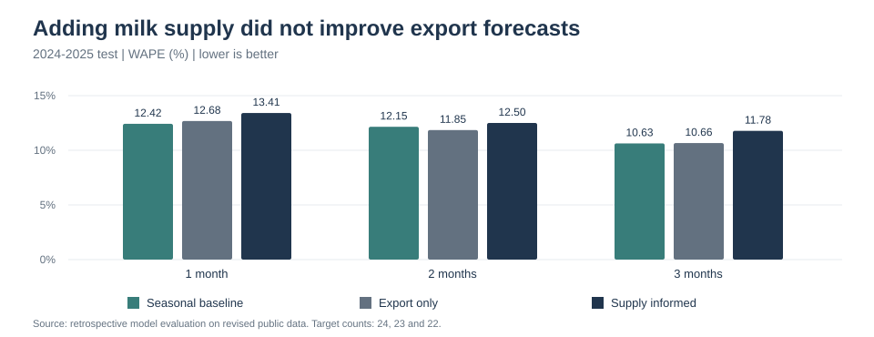

# NZ Dairy Supply & Export Planning Intelligence

**An Excel-based business analysis case study | New Zealand dairy sector | 2015-2025**

## Executive summary

New Zealand's dairy sector has pronounced seasonal milk collection patterns, but milk supply and export shipments do not necessarily move together. A planning team needs a dependable starting forecast, a clear way to monitor changes and a practical process for investigating significant deviations.

This independent case study turns publicly reported monthly milk collection and domestic whole milk powder (WMP) export statistics into an auditable Excel planning review. It tests whether earlier milk supply adds value to a forecast of export shipments, rather than assuming that more milk automatically means more exports.

| Coverage | Source review | Forecast test | Decision |
|:---|---:|:---|:---|
| **132 matched months** | **735,118 export rows screened** | **2024-2025 held-out period** | **Retain seasonal baseline** |

| 2025 performance | 2024 | 2025 | Change |
|:---|---:|---:|---:|
| Milk supply (million kg milk solids) | 1,923.86 | 1,975.74 | **+2.70%** |
| Selected domestic WMP exports (million kg powder) | 1,343.21 | 1,304.78 | **-2.86%** |

**Decision:** use last year's same-month volume as the reference export forecast. Monitor supply separately and investigate material shipment deviations before overriding the forecast.

## 1. Business problem and scope

**Question:** Can available milk supply observations improve a one- to three-month outlook for New Zealand domestic WMP exports compared with using export history alone?

The intended users are planning, supply chain and operations analysts reviewing monthly sector-level volumes. The goal is better-informed investigation, not a claim of business savings or a manufacturer-level inventory plan.

| Hypothesis | Test | Outcome |
|---|---|---|
| H1: Seasonality improves the forecast | Seasonal baseline vs latest-available-month forecast | Supported in the one-month held-out comparison |
| H2: Earlier milk supply improves WMP forecasting | Comparable export-only and supply-informed models, 1-3 months | Not supported in these tests |

## 2. Key insights

### 01 | Seasonal supply and export patterns are different

Milk collection peaks in October (average 260.68 million kg milk solids) and reaches its low in June (18.75 million kg), approximately 13.9 times lower than the peak. The selected domestic WMP export series peaks in December and reaches its low in August. The two-month difference between average peaks is descriptive, not a demonstrated production-to-shipment lag.

**Implication:** a single month-to-month planning rule can miss recurring seasonal shifts. Use separate seasonal profiles for raw milk collection and finished-product shipments.

### 02 | More milk does not necessarily mean more export shipments

In 2025, milk supply rose by 2.70% while selected domestic WMP exports fell by 2.86%. Four months had opposite year-on-year directions: March, April, May and November. May and November were the largest monthly export declines in absolute volume compared with the corresponding 2024 months.

| Month | Milk supply YoY | Domestic WMP exports YoY | Export volume change |
|---|---:|---:|---:|
| May 2025 | +7.43% | -22.21% | -27.86 million kg |
| November 2025 | +2.69% | -15.52% | -24.27 million kg |

**Implication:** national milk collections alone do not explain how product mix, shipment timing, customer demand or stock movements influence export volume. Those are investigation topics, not established causes.

### 03 | A simpler seasonal forecast is a strong starting point

One-month-ahead test error (WAPE, lower is better):

| Series | Latest available month | Same month last year |
|---|---:|---:|
| Milk supply | 47.02% | **3.16%** |
| Domestic WMP exports | 30.66% | **12.42%** |

Adding lagged milk supply to an otherwise comparable export-history model increased held-out export forecast error at every horizon.

| Horizon | Test months | Seasonal | Export only | Supply informed |
|---|---:|---:|---:|---:|
| 1 month | 24 | **12.42%** | 12.68% | 13.41% |
| 2 months | 23 | 12.15% | **11.85%** | 12.50% |
| 3 months | 22 | **10.63%** | 10.66% | 11.78% |

The seasonal baseline was selected using 2022-2023 validation, before scoring the test period. The export-only model was slightly better at the two-month test horizon. These results do not establish statistical significance or causation. WAPE is total absolute forecast error divided by total actual volume.

### 04 | Make exceptions actionable, not automatic overrides

A proposed review threshold of **39.08 million kg** was derived from the fifth-largest absolute seasonal forecast error in the 24-month validation period. Applying that fixed threshold to 2024-2025 flags one month.

| Review item | February 2024 |
|---|---:|
| Forecast | 85.76 million kg |
| Actual domestic exports | 138.60 million kg |
| Actual minus forecast | **+52.84 million kg** |
| Review threshold | 39.08 million kg |
| Action | Investigate shipment deviation |

The threshold is an analyst-proposed screening rule, not a confidence interval or approved business tolerance.

## 3. Recommendations and monthly review process

| Recommended action | Proposed owner | Timing | Evidence to review |
|---|---|---|---|
| Use same-month-last-year as the export baseline | Planning analyst | Monthly | WAPE, MAE and signed bias |
| Keep milk supply and export shipment views separate | Supply chain analyst | Monthly | Seasonal profiles and YoY movements |
| Investigate unusually large shipment deviations before overriding the baseline | Planning and export operations | When threshold is exceeded | Dispatch timing, shipment schedules and reliable market context |
| Check source revisions before adopting refreshed analysis | Analyst responsible for reporting | Every refresh | 132-month reconciliation; refit coefficients if the historical snapshot changes |
| Review the exception threshold with stakeholders | Planning lead | Before operational adoption | Historical false alerts and missed material events |

These are proposed actions for a planning review, not implemented company changes or verified financial benefits.

## 4. Data foundation and quality

| Source | Scope | Treatment |
|---|---|---|
| [DCANZ / NZX / DairyNZ](https://dcanz.com/resources/) | Monthly national milk solids collected for processing | Convert thousand kg to kg; retain 2015-2025 |
| [Stats NZ overseas merchandise trade](https://www.stats.govt.nz/large-datasets/csv-files-for-download/overseas-merchandise-trade-datasets/) | 11 annual national HS10 exports files | Filter HS10 0402210019; use domestic exports, KGM, Final |
| Joined monthly dataset | 132 months | Merge on month-start date; check duplicates, coverage and quantities |

No synthetic inputs. All selected export records reconcile domestic exports plus re-exports to total exports. The milk source and complete joined workbook remain local pending confirmation of reuse rights. The [public Stats NZ extract](data/public/wmp_exports_2015_2025.csv) contains 132 selected records; [source manifest](data/raw_source_manifest.csv) identifies the original 11 files. See [data reuse](data/README.md).

## 5. Excel solution

| Component | Function | Evidence |
|---|---|---|
| Power Query | Import, filter, append 11 CSVs, merge two sources | Three native queries saved in the local workbook after successful Mac previews |
| Data lineage | Original, staging, processed and reconciliation views | 132 matched months; 1,320 joined output cells matched the audited snapshot within tolerance |
| Excel Tables and PivotTables | Annual totals and calendar-month seasonality | Two native PivotTables; desktop refresh acceptance still pending |
| Year Review | Dropdown-driven annual and monthly comparison | SUMIFS, IFERROR, conditional formatting |
| Forecast Review | Model comparison, WAPE, MAE, bias and coefficients | Excel formulas applying fixed regression coefficients estimated with NumPy |
| Planning Exceptions and Outlook | Evidence-based review threshold and three-month retrospective outlook | Explicit thresholds and forecast origin |
| Executive Dashboard | Formula-driven KPIs, monthly charts and source-match gate | [Dashboard build script](excel/BuildExecutiveDashboard.ts); desktop execution not yet verified |

**Refresh design:** original files -> MilkSupply and WMPExports -> MonthlyPlanning -> source match check -> audited Monthly Data snapshot -> analysis and recommendations. A changed snapshot requires reviewing model coefficients and rerunning evaluation. It must not silently overwrite the evaluated historical data.

## 6. Reproduce and inspect the work

- [Data preparation](docs/data_preparation.md) - source selection, transformation and quality checks.
- [Excel analysis](docs/excel_review.md) - initial validation and Excel methods.
- [Forecast evaluation](docs/forecast_evaluation.md) - training, validation, test design and model limitations.
- [Desktop Excel acceptance and dashboard setup](docs/excel_acceptance.md) - native connection evidence, dashboard build and release checks.
- [Power Query reference script](powerquery/MonthlyPlanning.m) - original one-query reference; Mac required separate queries and fixed paths.

The public repository contains documentation, charts, code and the attributed export extract. It does not contain the complete raw exports yet or the restricted milk workbook. Download source data independently using the documented links. This is an independent portfolio case study, not a commissioned client project.

## 7. Limitations

- Exports are realised shipments, not unconstrained demand or customer orders. Milk solids and WMP have different physical meanings and cannot be subtracted to calculate an inventory gap.
- HS10 0402210019 is a narrowly defined WMP category, not all dairy exports.
- Forecasts use revised historical statistics and an assumed one-month publication delay. Historical release vintages were unavailable; the test is retrospective, not a fully blinded real-time experiment.
- The test covers a limited number of months. Different forecast horizons have different target counts.
- No operational savings, causal relationships, stockouts, manufacturing capacity or forecast adoption are claimed.

## 8. Release status

Core analysis, model evaluation, source reconciliation and three native Power Query connections are complete. The final Excel dashboard script and desktop acceptance procedure are available. Final desktop execution, refresh, slicer and visual checks remain outstanding before the workbook is described as release-ready.
